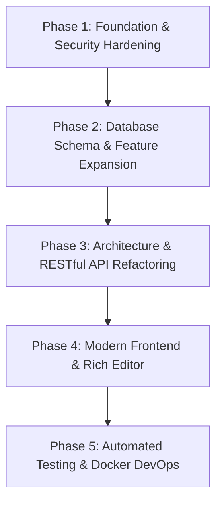

# Blog App Upgrade & Modernization Blueprint

> **Project:** Blog Application Development Upgrade  
> **Repository:** [blogapp-development-project](https://github.com/ASandaruwan/blogapp-development-project)  
> **Current Tech Stack:** PHP (Procedural/API), MySQL (PDO), HTML5/CSS3/Vanilla JS  
> **Target Architecture:** Modern MVC/Layered PHP Backend, RESTful API v1, Secure Token/Session Auth, Component-based Frontend

---

## 1. Executive Summary

The current project is a functional, lightweight full-stack blog application featuring user authentication, CRUD operations for blog posts, pagination, basic search, and a markdown editor. 

To transform this academic/introductory web programming project into a **production-ready, secure, scalable, and modern web application**, this upgrade blueprint identifies architectural gaps, security vulnerabilities, and feature expansions, detailing a 5-phase development roadmap.

```
Current State                               Target Upgraded State
┌─────────────────────────┐                 ┌─────────────────────────┐
│ Procedural PHP Scripts  │                 │ Clean MVC / OOP Router  │
│ Hardcoded Config (.php) │                 │ Environment (.env)      │
│ No CSRF Protection      │   ──────────►   │ CSRF + Rate Limiting    │
│ Basic Regex Markdown    │                 │ Marked.js + DOMPurify   │
│ Single Table Blog Posts │                 │ Categories, Tags, Comments│
│ Raw IDs in URLs         │                 │ SEO Slugs & REST API    │
└─────────────────────────┘                 └─────────────────────────┘
```

---

## 2. Current Architecture & Codebase Audit

### 2.1 File Map & Responsibilities
* **`config/database.php` & `config/config.php`**: Database credentials and session helpers (`isLoggedIn()`, `escape()`).
* **`api/auth/`**:
  * `login.php` - Validates credentials, sets `$_SESSION`.
  * `register.php` - Validates input, hashes password (`PASSWORD_DEFAULT`), creates user.
  * `logout.php` - Destroys session.
* **`api/blogs/`**:
  * `create.php`, `update.php`, `delete.php` - JSON endpoints handling post creation, editing, and deletion with ownership checks.
  * `get.php` - Fetch single post or paginated search results.
* **`assets/js/`**:
  * `auth.js`, `blog.js`, `editor.js`, `main.js` - Client-side fetch calls and custom regex markdown parser.
* **`database/schema.sql`**: Contains `user` and `blogPost` tables.

### 2.2 Strengths
- Uses **PDO prepared statements** for database queries (protects against primary SQL injections).
- Uses **`password_hash()`** with bcrypt for secure password storage.
- Basic authorization checks prevent non-owners from editing or deleting other users' posts.
- Client-side pagination and async search with result counters.

---

## 3. Vulnerability & Technical Debt Analysis

### 🚨 Critical Security Issues
1. **No CSRF Protection**:
   * All state-changing endpoints (`/api/blogs/create.php`, `update.php`, `delete.php`, `/api/auth/login.php`, `register.php`) accept POST requests without verifying CSRF tokens. A cross-site attacker could force a logged-in user to create, edit, or delete posts.
2. **XSS Risk in Markdown Rendering**:
   * The client-side markdown parser uses basic regular expressions (`assets/js/editor.js` and `blog.js`) to replace markdown tags with HTML tags without sanitizing HTML entities or removing `<script>` / `javascript:` pseudo-protocols.
3. **Database Exception Leaks**:
   * Catch blocks return `$e->getMessage()` in JSON outputs, exposing table names, server paths, and SQL query details to users.
4. **Session Vulnerabilities**:
   * Missing `session_regenerate_id(true)` upon authentication (vulnerable to session fixation).
   * Missing security flags on session cookies (`HttpOnly`, `SameSite=Lax/Strict`, and `Secure`).
5. **CORS Misconfiguration**:
   * `api/blogs/get.php` sets `Access-Control-Allow-Origin: *` while simultaneously setting `Access-Control-Allow-Credentials: true`, which is invalid and insecure under modern browser specs.

### ⚙️ Architectural & Feature Limitations
1. **Hardcoded Credentials**: Database username and password are hardcoded into `config/database.php`.
2. **Missing SEO URLs**: Posts are accessed via `blog.php?id=1` instead of human-readable slugs (`/blog/understanding-php-pdo`).
3. **Flat Content Model**: No support for categories, tags, post thumbnails/cover images, or reader comments.
4. **No Draft / Publish Workflow**: Posts are published immediately upon creation without draft or visibility controls.
5. **No Centralized Routing**: Every page and API endpoint is an individual `.php` file instead of passing through a front-controller (`index.php`) with router support.

---

## 4. Phase-by-Phase Upgrade Roadmap



### Phase 1: Foundation & Security Hardening (Immediate Priority)
- [ ] **Environment Configuration**:
  - Add `vlucas/phpdotenv` or a native `.env` parser.
  - Create `.env.example` and add `.env` to `.gitignore`.
- [ ] **CSRF Defense**:
  - Generate a cryptographic CSRF token stored in `$_SESSION['csrf_token']`.
  - Provide a meta tag `<meta name="csrf-token" content="...">` and include `X-CSRF-TOKEN` header on all AJAX POST/PUT/DELETE calls.
- [ ] **Session Hardening**:
  - Configure `session_set_cookie_params([ 'lifetime' => 86400, 'httponly' => true, 'samesite' => 'Lax', 'secure' => isset($_SERVER['HTTPS']) ])`.
  - Regenerate session ID on login and logout.
- [ ] **Centralized Error & Exception Handler**:
  - Mask database exceptions in production; return generic error messages with logged IDs.
- [ ] **Rate Limiting**:
  - Implement request throttling for `api/auth/login.php` (e.g. max 5 failed attempts per 15 minutes per IP).

---

### Phase 2: Database Schema & Feature Expansion
- [ ] **Enhanced Database Tables**:
  - Add `categories` table (`id`, `name`, `slug`, `description`).
  - Add `tags` and `post_tags` (many-to-many relationship).
  - Add `comments` table (`id`, `post_id`, `user_id`, `content`, `created_at`, `status`).
  - Update `blogPost` table with:
    - `slug VARCHAR(255) UNIQUE`
    - `summary VARCHAR(500)`
    - `status ENUM('draft', 'published', 'archived') DEFAULT 'draft'`
    - `featured_image VARCHAR(255) NULL`
    - `view_count INT DEFAULT 0`
    - `reading_time INT DEFAULT 1`
  - Update `user` table with:
    - `avatar VARCHAR(255) NULL`
    - `bio TEXT NULL`
    - `is_active BOOLEAN DEFAULT TRUE`
    - `reset_token VARCHAR(100) NULL`
    - `reset_token_expires_at TIMESTAMP NULL`
- [ ] **File Upload Support**:
  - Secure image upload service for post covers and avatar pictures (MIME-type validation, size limits, filename hashing).

---

### Phase 3: Architecture & RESTful API Modernization
- [ ] **Directory Reorganization (Clean Architecture)**:
  ```
  blog-app/
  ├── app/
  │   ├── Controllers/     # AuthController, PostController, CommentController
  │   ├── Models/          # User, BlogPost, Category, Comment
  │   ├── Middleware/      # AuthMiddleware, CsrfMiddleware, RateLimitMiddleware
  │   ├── Services/        # AuthService, PostService, FileUploadService
  │   └── Database/        # Connection, Migration runner
  ├── config/              # app.php, database.php
  ├── public/              # Document root (index.php, assets/)
  ├── views/               # PHP templates or component views
  ├── routes/              # api.php, web.php
  ├── storage/             # uploads, logs, cache
  ├── composer.json        # Autoloader & dependencies
  └── .env
  ```
- [ ] **Front Controller & Routing**:
  - Implement a lightweight regex router (`/api/v1/posts`, `/posts/{slug}`).
  - Standardize API JSON response structure:
    ```json
    {
      "status": "success",
      "data": {},
      "message": "Operation completed",
      "meta": { "page": 1, "total": 45, "limit": 10 }
    }
    ```

---

### Phase 4: Frontend & Editor Enhancements
- [ ] **Secure Markdown Rendering**:
  - Replace regex parser with **`marked.js`** + **`DOMPurify`** to prevent XSS.
- [ ] **Modern WYSIWYG / Markdown Features**:
  - Add image drag-and-drop / upload directly into editor.
  - Syntax highlighting for code blocks (using Highlight.js or Prism.js).
  - Word count, reading time calculator, and autosave to `localStorage`.
- [ ] **Interactive UI Elements**:
  - Comments section with real-time add/delete.
  - Reading progress bar and responsive mobile navigation.
  - Toast notification system (replacing default alert/error boxes).
  - Dark Mode toggle with preference saved in `localStorage`.

---

### Phase 5: Testing, DevOps & Deployment
- [ ] **Docker Containerization**:
  - `docker-compose.yml` defining `php:8.2-apache`, `mysql:8.0`, and `phpmyadmin`.
- [ ] **Automated Testing**:
  - Setup PHPUnit for backend unit and integration tests (auth flow, CRUD permissions).
- [ ] **CI/CD Pipeline**:
  - GitHub Actions workflow for linting (PHP_CodeSniffer / PHPStan) and running test suites.

---

## 5. Upgraded Database Schema (Reference DDL)

```sql
-- Upgraded Database Schema for Blog Application
CREATE DATABASE IF NOT EXISTS blog_app CHARACTER SET utf8mb4 COLLATE utf8mb4_unicode_ci;
USE blog_app;

-- 1. Users Table
CREATE TABLE IF NOT EXISTS users (
    id INT UNSIGNED AUTO_INCREMENT PRIMARY KEY,
    username VARCHAR(50) NOT NULL UNIQUE,
    email VARCHAR(100) NOT NULL UNIQUE,
    password VARCHAR(255) NOT NULL,
    role ENUM('admin', 'author', 'user') DEFAULT 'user',
    avatar VARCHAR(255) DEFAULT NULL,
    bio TEXT DEFAULT NULL,
    is_active BOOLEAN DEFAULT TRUE,
    reset_token VARCHAR(100) DEFAULT NULL,
    reset_expires_at TIMESTAMP NULL,
    created_at TIMESTAMP DEFAULT CURRENT_TIMESTAMP,
    updated_at TIMESTAMP DEFAULT CURRENT_TIMESTAMP ON UPDATE CURRENT_TIMESTAMP,
    INDEX idx_user_role (role)
) ENGINE=InnoDB DEFAULT CHARSET=utf8mb4 COLLATE=utf8mb4_unicode_ci;

-- 2. Categories Table
CREATE TABLE IF NOT EXISTS categories (
    id INT UNSIGNED AUTO_INCREMENT PRIMARY KEY,
    name VARCHAR(100) NOT NULL,
    slug VARCHAR(100) NOT NULL UNIQUE,
    description VARCHAR(255) DEFAULT NULL,
    created_at TIMESTAMP DEFAULT CURRENT_TIMESTAMP
) ENGINE=InnoDB DEFAULT CHARSET=utf8mb4 COLLATE=utf8mb4_unicode_ci;

-- 3. Posts Table
CREATE TABLE IF NOT EXISTS posts (
    id INT UNSIGNED AUTO_INCREMENT PRIMARY KEY,
    user_id INT UNSIGNED NOT NULL,
    category_id INT UNSIGNED NULL,
    title VARCHAR(255) NOT NULL,
    slug VARCHAR(255) NOT NULL UNIQUE,
    summary VARCHAR(500) DEFAULT NULL,
    content MEDIUMTEXT NOT NULL,
    featured_image VARCHAR(255) DEFAULT NULL,
    status ENUM('draft', 'published', 'archived') DEFAULT 'draft',
    views INT UNSIGNED DEFAULT 0,
    created_at TIMESTAMP DEFAULT CURRENT_TIMESTAMP,
    updated_at TIMESTAMP DEFAULT CURRENT_TIMESTAMP ON UPDATE CURRENT_TIMESTAMP,
    published_at TIMESTAMP NULL,
    FOREIGN KEY (user_id) REFERENCES users(id) ON DELETE CASCADE,
    FOREIGN KEY (category_id) REFERENCES categories(id) ON DELETE SET NULL,
    INDEX idx_post_status (status),
    INDEX idx_post_published (published_at),
    FULLTEXT idx_post_search (title, content)
) ENGINE=InnoDB DEFAULT CHARSET=utf8mb4 COLLATE=utf8mb4_unicode_ci;

-- 4. Tags & Post Tags (Many-to-Many)
CREATE TABLE IF NOT EXISTS tags (
    id INT UNSIGNED AUTO_INCREMENT PRIMARY KEY,
    name VARCHAR(50) NOT NULL UNIQUE,
    slug VARCHAR(50) NOT NULL UNIQUE
) ENGINE=InnoDB DEFAULT CHARSET=utf8mb4 COLLATE=utf8mb4_unicode_ci;

CREATE TABLE IF NOT EXISTS post_tags (
    post_id INT UNSIGNED NOT NULL,
    tag_id INT UNSIGNED NOT NULL,
    PRIMARY KEY (post_id, tag_id),
    FOREIGN KEY (post_id) REFERENCES posts(id) ON DELETE CASCADE,
    FOREIGN KEY (tag_id) REFERENCES tags(id) ON DELETE CASCADE
) ENGINE=InnoDB DEFAULT CHARSET=utf8mb4 COLLATE=utf8mb4_unicode_ci;

-- 5. Comments Table
CREATE TABLE IF NOT EXISTS comments (
    id INT UNSIGNED AUTO_INCREMENT PRIMARY KEY,
    post_id INT UNSIGNED NOT NULL,
    user_id INT UNSIGNED NOT NULL,
    content TEXT NOT NULL,
    status ENUM('approved', 'pending', 'spam') DEFAULT 'approved',
    created_at TIMESTAMP DEFAULT CURRENT_TIMESTAMP,
    FOREIGN KEY (post_id) REFERENCES posts(id) ON DELETE CASCADE,
    FOREIGN KEY (user_id) REFERENCES users(id) ON DELETE CASCADE,
    INDEX idx_comment_post (post_id)
) ENGINE=InnoDB DEFAULT CHARSET=utf8mb4 COLLATE=utf8mb4_unicode_ci;
```

---

## 6. Getting Started With the Upgrades

When ready to implement, tackle features in order:
1. **Step 1:** Establish `.env` and CSRF protection in the current codebase without breaking existing endpoints.
2. **Step 2:** Integrate `DOMPurify` and `marked.js` to secure the editor and preview modes.
3. **Step 3:** Run the upgraded database migrations to add categories and tags.
4. **Step 4:** Refactor endpoints into structured classes or services.
